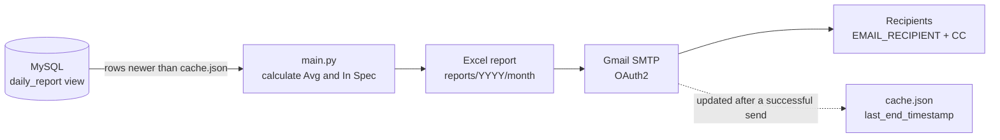

# QualityReportDataFlow


Daily **QID (Quality Inspection Device)** report. Each run reads the new inspections from MySQL, calculates the CW / BE / ME results against spec, saves them as an Excel report and emails it through Gmail.

**Installation guide:** [English](installation-module/module-en.md) · [Bahasa Indonesia](installation-module/module-id.md)

---

## Quick links

| | English | Bahasa Indonesia |
| --- | --- | --- |
| 📘 Full installation guide | [module-en.md](installation-module/module-en.md) | [module-id.md](installation-module/module-id.md) |
| 💻 Install software | [Section 1](installation-module/module-en.md#1-install-the-software) | [Bagian 1](installation-module/module-id.md#1-instal-perangkat-lunak) |
| 📦 Install Python packages | [Section 2](installation-module/module-en.md#2-install-the-python-packages) | [Bagian 2](installation-module/module-id.md#2-instal-paket-python) |
| 🗄️ Set up the database | [Section 3](installation-module/module-en.md#3-set-up-the-database) | [Bagian 3](installation-module/module-id.md#3-siapkan-database) |
| ⚙️ Fill in `.env` | [Section 4](installation-module/module-en.md#4-fill-in-the-env-file) | [Bagian 4](installation-module/module-id.md#4-isi-file-env) |
| ✉️ Gmail OAuth setup | [Section 5](installation-module/module-en.md#5-set-up-gmail-sending-google-cloud-console) | [Bagian 5](installation-module/module-id.md#5-siapkan-pengiriman-gmail-google-cloud-console) |
| ▶️ Run the report | [Section 6](installation-module/module-en.md#6-run-the-report) | [Bagian 6](installation-module/module-id.md#6-jalankan-laporan) |
| ⏰ Schedule daily runs | [Section 7](installation-module/module-en.md#7-run-it-automatically-every-day) | [Bagian 7](installation-module/module-id.md#7-jalankan-otomatis-setiap-hari) |
| 🛠️ Troubleshooting | [Section 8](installation-module/module-en.md#8-troubleshooting) | [Bagian 8](installation-module/module-id.md#8-pemecahan-masalah) |

---

## How it works



1. **Load** `.env` and decrypt the stored secrets.
2. **Query** the `daily_report` view for rows whose `End` is later than `last_end_timestamp` in `cache.json`.
3. **Calculate** the averages and in-spec results for each row.
4. **Write** the Excel report to `reports\<year>\<month>\`.
5. **Send** it through Gmail to `EMAIL_RECIPIENT`, with `LIST_CC_EMAIL` in CC.
6. **Remember** the newest `End` time in `cache.json`. This only happens after a successful send, so failed rows are sent again on the next run.

---

## Quick start

```bat
setup\python-configurations.bat          :: install packages, create .env
python script\create_key.py              :: encryption key for .env
python script\encrypt_value.py "<value>" :: encrypt MYSQL_PASSWORD / OAUTH_CLIENT_SECRET
python script\create_oauth_token.py      :: one-time Gmail sign-in, prints OAUTH_REFRESH_TOKEN
python main.py                           :: run the report
```

Run [`installation-module/sql-configuration.sql`](installation-module/sql-configuration.sql) on the database first. To send the report every day, point Windows Task Scheduler at `setup\run-report.bat`.

---

## What's in the report

Every row from `daily_report` gets these calculated columns:

| Column | Calculation | Spec (target ± tolerance) |
| --- | --- | --- |
| `Avg Cw [First]` / `Avg Cw [Second]` | `Avg CW [1]` ÷ 3 and `Avg CW [2]` ÷ 3 | — |
| `Avg Cw` | Mean of First and Second | — |
| `Avg Dia Be` | Mean of `UB [1]` … `UB [6]` | — |
| `Avg Dia Me` | Mean of `UH [1]` … `UH [6]` | — |
| `In Spec Cw` | Share of First / Second inside spec, from 0 to 1 | 2.02 ± 0.14 |
| `In Spec Be` | Share of `UB [1]` … `UB [6]` inside spec, from 0 to 1 | 10.0 ± 0.25 |
| `In Spec Me` | Share of `UH [1]` … `UH [6]` inside spec, from 0 to 1 | 8.0 ± 0.25 |

Missing measurements are skipped, not counted as zero. Each row also gets `Tanggapan ID`, the dates, and the fixed values from `.env` (`PLANT`, `LOCATION`, `GROUP`, `BRAND`, `BAGIAN`, `SET_SAMPLE`). The targets and tolerances are the `TARGET_*` / `TOLERANCE_*` constants in [`main.py`](main.py).

---

## Configuration at a glance

All settings live in `.env`. Copy them from [`.env.example`](.env.example). 🔒 marks a value stored encrypted with `script\encrypt_value.py`.

| Group | Keys |
| --- | --- |
| Encryption | `ENCRYPTION_ALGORITHM`, `ENCRYPTION_KEY` |
| Database | `MYSQL_HOST`, `MYSQL_PORT`, `MYSQL_DATABASE`, `MYSQL_USER`, `MYSQL_PASSWORD` 🔒 (empty = no password) |
| Gmail | `SMTP_USER`, `OAUTH_CLIENT_ID`, `OAUTH_CLIENT_SECRET` 🔒, `OAUTH_REFRESH_TOKEN` 🔒 |
| Recipients | `EMAIL_RECIPIENT` (comma-separated), `EMAIL_SUBJECT` *(optional)* |
| Report values | `PLANT`, `LOCATION`, `GROUP`, `BRAND`, `BAGIAN`, `SET_SAMPLE` |
| Optional Gmail | `EMAIL_SENDER`, `SMTP_PORT`, `SMTP_SECURITY`, `SMTP_TIMEOUT` |

Some settings live in [`main.py`](main.py) rather than `.env`: `LIST_CC_EMAIL` (CC addresses), `EMAIL_BODY`, and the spec `TARGET_*` / `TOLERANCE_*` values.

---

## Tools

| File | What it does | When to use it |
| --- | --- | --- |
| `setup\environment.bat` | Installs Python 3.13, Git and Notepad++ with winget, then clones the repo into `C:\` | New PC, run as administrator |
| `setup\python-configurations.bat` | Installs `requirements.txt` and creates `.env` from `.env.example` | After download or after an update |
| `setup\run-report.bat` | Runs `main.py` and appends the output to `report.log` | Task Scheduler |
| `script\create_key.py` | Prints a new `ENCRYPTION_KEY` | Once |
| `script\encrypt_value.py` | Encrypts a value for `.env` | For every 🔒 value |
| `script\decrypt_value.py` | Shows the original value of an encrypted token | To check a value |
| `script\create_oauth_token.py` | Gmail sign-in in the browser, prints `OAUTH_REFRESH_TOKEN` | Once, and again if Google rejects the token |
| `installation-module\sql-configuration.sql` | Creates the `daily_report` view and its indexes | Once per database |
| `main.py` | The report flow | Every run |

---

## Outputs

| Where | What |
| --- | --- |
| `reports\<year>\<month>\quality_report_<YYYYMMDD_HHMMSS>.xlsx` | The report: one Excel table (`Users`) on sheet `users` |
| `cache.json` | `last_end_timestamp`: the next run only sends rows that ended after it |
| `report.log` | Output of every run started by `setup\run-report.bat` |

---

## Project structure

```text
QualityReportDataFlow/
├── main.py                  the report flow (run this)
├── cache.json               newest row already sent
├── requirements.txt         Python packages
├── .env.example             settings template; copy to .env
├── src/                     building blocks used by main.py
│   ├── DatabaseConnection.py    MySQL connection and queries
│   ├── EmailManager.py          Gmail SMTP sending (OAuth2)
│   ├── OAuthManager.py          Google OAuth tokens
│   ├── EncryptionManager.py     AES-GCM encryption for .env secrets
│   ├── EnvManager.py            reads .env
│   ├── ExcelManager.py          writes the Excel table
│   └── FileManager.py           folders and files
├── script/                  one-time setup tools
├── setup/                   Windows batch files
├── installation-module/     installation guides (EN / ID) and the SQL setup
└── test/                    manual check scripts
```

---

## Checks

| Script | What it checks | Needs |
| --- | --- | --- |
| `python test\TestEncryptionManager.py` | Encryption round-trip, tamper and wrong-key detection | Nothing |
| `python test\TestEnvManager.py` | Lists the keys found in `.env` | `.env` |
| `python test\TestEmailManager.py` | Sends a test email through Gmail to `EMAIL_RECIPIENT` | Complete `.env` |
| `test\TestMysqlConnector.py`, `TestExcelManager.py`, `TestFileManager.py` | Developer tests against a sample `users` table and `output\` folder | Developer database |
